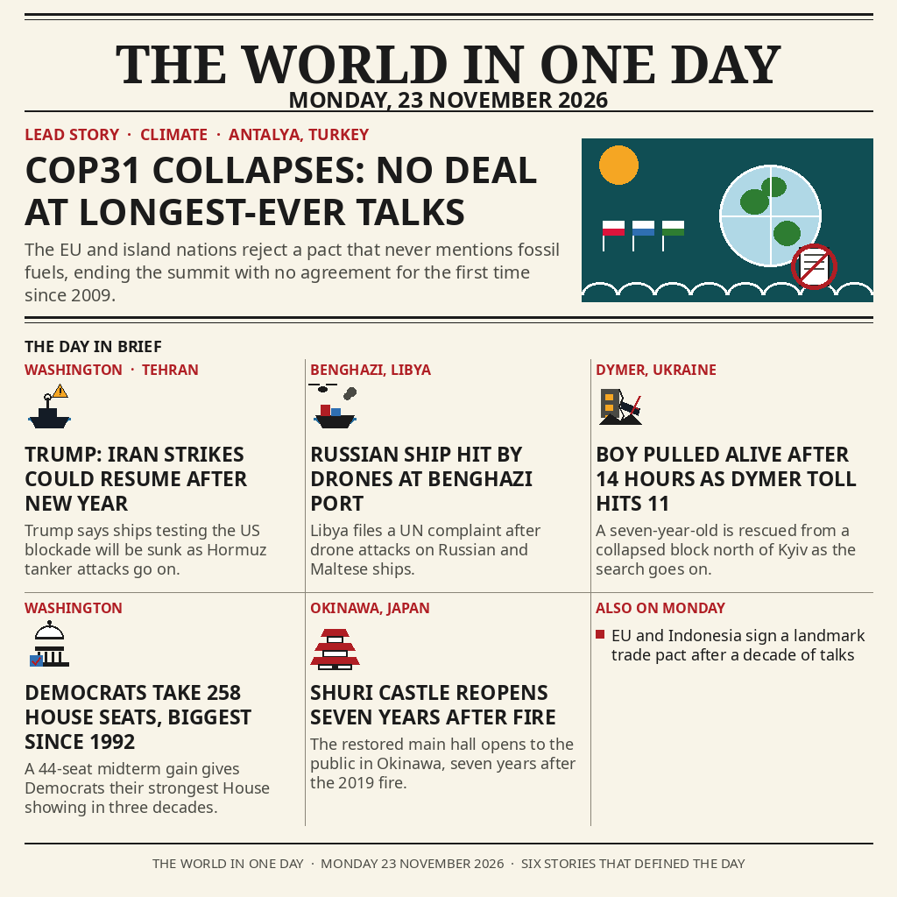

# The World in One Day — Monday, 23 November 2026

One image summing up Monday 23 November 2026's world news, for the
[make.fun](https://make.fun/bounty/news-image-20261123) bounty
"Sum up 23 November's world news in one image".

## The six stories

1. **COP31 collapses: no deal at longest-ever talks** — the EU and
   island nations reject a pact that never mentions fossil fuels,
   ending the Antalya summit with no agreement for the first time
   since 2009.
2. **Trump: Iran strikes could resume after New Year** — Trump says
   ships testing the US blockade will be sunk as Hormuz tanker
   attacks go on.
3. **Russian ship hit by drones at Benghazi port** — Libya files a
   UN complaint after drone attacks on Russian and Maltese ships.
4. **Boy pulled alive after 14 hours as Dymer toll hits 11** — a
   seven-year-old is rescued from a collapsed block north of Kyiv
   as the search goes on.
5. **Democrats take 258 House seats, biggest since 1992** — a
   44-seat midterm gain gives Democrats their strongest House
   showing in three decades.
6. **Shuri Castle reopens seven years after fire** — the restored
   main hall opens to the public in Okinawa, seven years after
   the 2019 fire.

Also on Monday: EU and Indonesia sign a landmark trade pact after
a decade of talks.

## How it was made

`draw.py` renders `entry.png` (1024×1024, under 1 MiB) with Python +
Pillow: a newspaper front page — a serif masthead naming the day, a lead
story with a drawn climate-summit scene (sun, globe, flags, sea waves and
a crossed-out pact), then five stories with drawn pictograms (warship and
warning triangle, drone-struck ship, collapsed block and ladder, Capitol
dome and ballot box, tiered castle roofs) and an "also on Monday" box. No
photos, no image-generation tools — every pixel is drawn
programmatically, and running `draw.py` twice produces a byte-identical
image.

`main.ts` (Node 22, standard library only) copies `entry.png` to the output
directory (`MAKEFUN_OUTPUT_DIR`, or `/output` by default).
